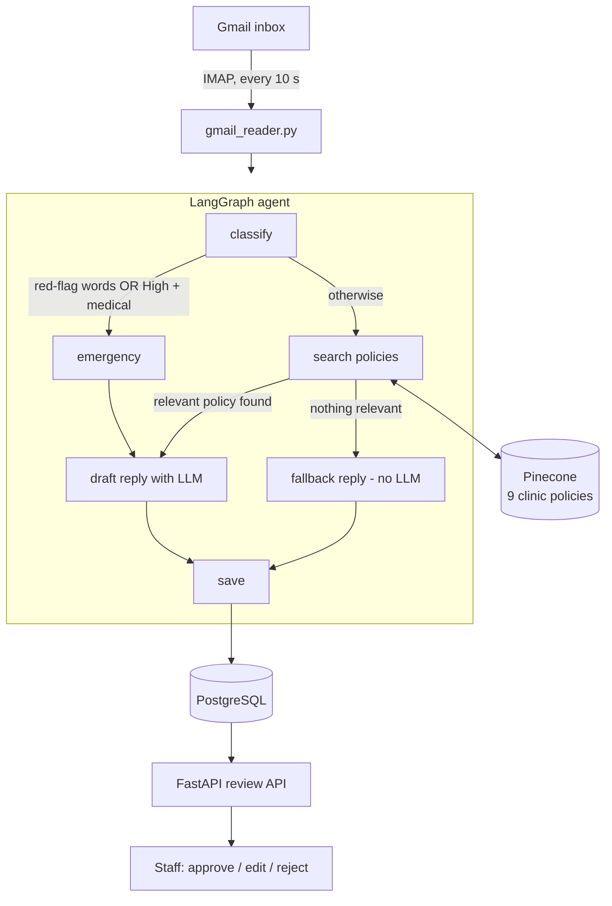

# Healthcare Email Triage Agent

An AI agent that reads incoming patient emails, decides how urgent they are, routes them to the right team, and drafts a reply grounded in clinic policy. **Every reply is reviewed and approved by a staff member before anything happens.**

Built with **LangGraph, OpenAI, Pinecone (RAG), FastAPI, PostgreSQL, and Gmail**, with an evaluation suite and CI tests.

> ⚠️ **Demo project.** All patient emails are made up and the clinic policies belong to a fictional organization ("Riverbend Health System"). This is not a HIPAA-compliant deployment and must not be used with real patient data.

---

## What it does

| Patient email | What the agent does |
|---|---|
| *"I have chest pain and my left arm is numb."* | **Emergency path**: skips document search, drafts a "call 911 now" reply, forces High priority, puts it at the top of the review queue |
| *"Can I set up a payment plan for my bill?"* | **Normal path**: searches clinic policies, drafts a reply grounded in the billing policy, routes to Billing |
| *"Is there a cafeteria in the building?"* | **Fallback path**: no relevant policy found, so it does **not** let the LLM guess; uses a pre-approved "a team member will follow up" reply and routes to Human Review |

Staff then review each draft in the API: approve it, edit it, or reject it with a reason. Every decision is logged with the reviewer's name and time.

---

## Architecture



| Layer | Technology |
|---|---|
| Agent orchestration | LangGraph (state graph with conditional routing) |
| Classification and drafting | OpenAI Responses API |
| Retrieval (RAG) | Pinecone + `all-MiniLM-L6-v2` sentence-transformer embeddings |
| Knowledge base | 9 hospital-style policy documents (billing, scheduling, records, refills, triage, etc.) |
| API | FastAPI (Swagger UI at `/docs`) |
| Database and containers | PostgreSQL + API in Docker Compose |
| Email | Gmail via IMAP |
| Quality | pytest unit tests, GitHub Actions CI, offline evaluation suite |

---

## Safety design

Healthcare emails can contain emergencies, so safety is built in at several independent layers:

1. **Red-flag keyword check (no AI):** phrases like "chest pain", "trouble breathing", "slurred speech", "overdose" always trigger the emergency path, even if the LLM misclassifies the email.
2. **LLM classification:** catches emergencies the keyword list misses (for example "my father collapsed and is not waking up").
3. **Emergency path forces High priority**, so urgent emails never sink in the review queue.
4. **Grounded drafting:** the draft prompt forbids diagnosing, recommending medication, or inventing policies, prices, or times.
5. **Fallback without the LLM:** if retrieval finds nothing relevant, a fixed pre-approved reply is used, so the model cannot hallucinate a policy.
6. **Human in the loop:** nothing is approved without a staff member, and rejections require a reason.
7. **Emails are never lost:** an email is marked as read in Gmail only after it has been saved; failures are retried.

---

## Evaluation

`evaluate.py` runs a labelled set of 23 patient emails (`eval_emails.csv`) through the agent's real classification and routing logic and scores it. It does not write drafts or touch the database.

| Metric | First run | Final |
|---|---|---|
| **Emergency recall** (emergencies caught) | 5/6 | **6/6** |
| False alarms | 0 | **0** |
| Category accuracy | 90% | **91%** |
| Route accuracy (emergency / normal / fallback) | 76% | **100%** |

The test set includes 4 emergencies that contain **no** red-flag keywords, to test the LLM layer on its own.

### What the evaluation found and fixed

1. **A one-letter bug was hiding emergencies.** The model sometimes answered `"Medical Question"` instead of `"Medical Questions"`. Strict validation rejected it, the fallback lowered the priority to Medium, and a stroke email was missed. **Fix:** label normalization (case and singular/plural tolerant). Emergency recall went from 5/6 to 6/6.
2. **The knowledge base was mostly noise.** A 409-page Medicare claims-processing manual (written for billing departments, not patients) made up most of the 2,596 vectors and polluted search results. **Fix:** replaced it with 9 focused patient-facing policies (77 vectors).
3. **Threshold re-tuned** from 0.40 to 0.35 for the cleaner knowledge base.

**Limitation:** the same 23 emails were used for both tuning and scoring, so these numbers are optimistic. A larger held-out set is the next step.

---

## Project structure

```
agent.py            LangGraph agent: state, nodes, and the graph
routing.py          Routing rules and red-flag keywords (plain Python, unit tested)
functions.py        LLM classification, validation, and label normalization
llm_service.py      Draft-reply generation with safety rules
vector_store.py     Pinecone upload and retrieval
rag_ingestion.py    Document loading (PDF, DOCX, TXT) and chunking
gmail_reader.py     Gmail polling; hands each email to the agent
database.py         PostgreSQL access
api.py              FastAPI endpoints for triage and staff review
evaluate.py         Offline evaluation suite
eval_emails.csv     Labelled test emails
knowledge_base/     9 clinic policy documents (.docx)
test_api.py         API tests (mocked, no real database or OpenAI calls)
test_routing.py     Routing and safety rule tests
init.sql            Database schema
compose.yaml        API + PostgreSQL in Docker
Dockerfile          API container image
```

---

## Review API

| Method | Endpoint | Purpose |
|---|---|---|
| GET | `/review-queue` | Drafts waiting for review, emergencies and High priority first |
| GET | `/emails/id/{id}` | One email with its draft |
| PUT | `/emails/{id}/draft` | Staff edits the draft before approving |
| PUT | `/emails/{id}/status` | Approve, or reject (a rejection reason is required) |
| POST | `/triage` | Classify a pasted email (testing) |
| GET | `/emails` | All emails |

Rules enforced by the API: only pending drafts can be edited, reviewed emails cannot be changed again, and rejections must include a reason.

---

## Running it locally

**1. Install**
```bash
git clone https://github.com/Pranavitha2306/Healthcare_Email_Triage.git
cd Healthcare_Email_Triage
pip install -r requirements.txt
```

**2. Create a `.env` file** (never commit it)
```
OPENAI_API_KEY=...
PINECONE_API_KEY=...
GMAIL_ADDRESS=...
GMAIL_APP_PASSWORD=...        # a Gmail app password, not your normal password
POSTGRES_PASSWORD=...
DB_HOST=127.0.0.1
DB_PORT=5540
```

**3. Start the database**
```bash
docker compose up -d db       # PostgreSQL, published on port 5540
```
(`docker compose up --build` starts both the API and the database in containers.)

**4. Load the clinic policies into Pinecone**
```bash
python vector_store.py
```

**5. Run**
```bash
uvicorn api:app --reload      # review API at http://127.0.0.1:8000/docs
python gmail_reader.py        # processes new emails every 10 seconds
```

**6. Test and evaluate**
```bash
pytest -v
python evaluate.py
```

---

## Design decisions

- **LangGraph instead of a free-form agent or a multi-agent framework.** In healthcare the paths must be predictable and auditable. LangGraph lets the LLM choose only between routes I defined, and every email records which route it took.
- **RAG instead of fine-tuning.** Clinic policies change often. Updating a document is faster and safer than retraining a model.
- **Deterministic rules on top of the LLM.** The LLM handles nuance; the keyword rule guarantees the obvious emergencies are never missed, even when the LLM fails.
- **Routing rules in their own module.** `routing.py` has no AI or network dependencies, so the safety rules are unit tested in CI on every push.

## Known limitations and next steps

- Approved replies are not yet sent back to the patient (planned: Gmail SMTP reply in the same thread).
- The API has no authentication yet; an API key or login is required before any cloud deployment.
- The keyword list is a safety net, not a complete clinical triage protocol.
- Next: OpenAI Structured Outputs to force valid labels, an LLM relevance check after retrieval, LLM-as-judge scoring for draft quality, a larger held-out evaluation set, and deployment on Azure (with Azure OpenAI for HIPAA-eligible processing).
